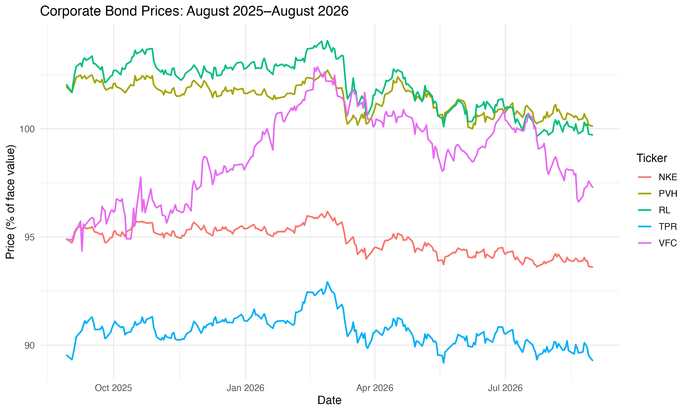
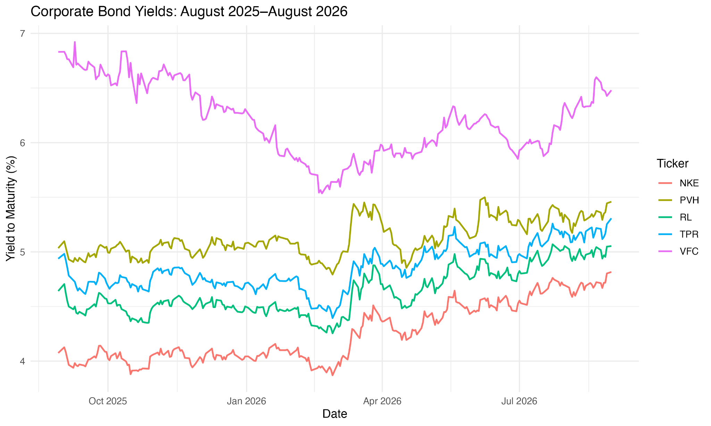
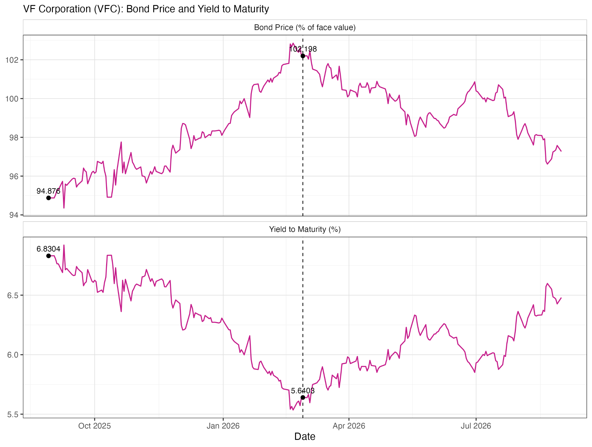
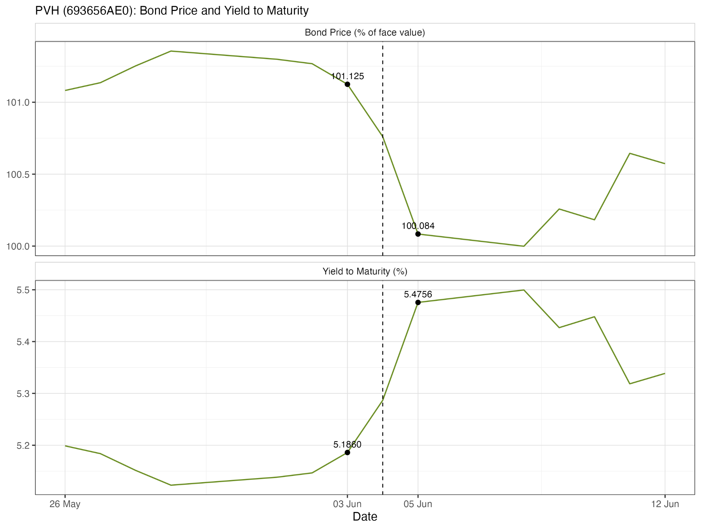

# Fashion Corporate Bonds

**Danmeng Hu (Chelsea Hu) | Financial Economics**

I compare the prices and yields of five fashion-related corporate bonds. I chose these companies because I follow their brands and want to understand how investors assess their ability to meet debt payments. The sample contains **252 observations per bond**, from **29 August 2025 to 31 August 2026**.

**[Read the project report](Bond_Project_DH.pdf)** · **[Assignment description](bond_project.pdf)** · **[R script](scripts/bond_project.R)**

## Files

| Location | Contents |
| --- | --- |
| `Bond_Project_DH.pdf` | Completed report, including interpretation, calculations, AI-use records and sources |
| `bond_project.pdf` | Course assignment description, copied from the instructor's repository |
| `data/` | Five original FactSet Excel workbooks |
| `scripts/bond_project.R` | Original R analysis script |
| `output/` | Nine CSV tables and five PNG figures |

The source filename `TRP` refers to Tapestry, whose ticker is `TPR` in the analysis.

## Selected bonds

All five are USD fixed-coupon bonds with semiannual payments and a verified face value of $1,000.

| Issuer | Ticker | CUSIP | Annual coupon | Maturity |
| --- | --- | --- | ---: | --- |
| Nike | NKE | 654106AK9 | 2.85% | 2030-03-27 |
| Ralph Lauren | RL | 751212AD3 | 5.00% | 2032-06-15 |
| Tapestry | TPR | 876030AA5 | 3.05% | 2032-03-15 |
| PVH | PVH | 693656AE0 | 5.50% | 2030-06-13 |
| VF Corporation | VFC | 918204AR9 | 6.00% | 2033-10-15 |

## Questions and outputs

| Question | Analysis | Files in `output/` |
| --- | --- | --- |
| Q1 | Bond selection and price histories | [Price table](output/q1_price_table.csv), [price chart](output/q1_bond_prices.png) |
| Q2 | Yield-to-maturity histories | [YTM table](output/q2_ytm_table.csv), [YTM chart](output/q2_bond_yields.png) |
| Q3 | Price-yield relationship, annual changes and issuer events | [Annual changes](output/q3_period_changes.csv), [largest daily YTM moves](output/q3_largest_ytm_moves.csv), [VF figure](output/fig_q3a_vf_price_yield.png), [PVH figure](output/fig_q3c_pvh_price_yield.png) |
| Q4 | Present-value calculation for Nike on 27 March 2026 | [Cash flows](output/q4_cash_flows.csv), [pricing comparison](output/q4_pricing_comparison.csv) |
| Q5 | Final-date yield ranking and maturity comparison | [Summary](output/q5_summary.csv), [maturity pairs](output/q5_maturity_pairs.csv), [yield comparison](output/q5_ytm_comparison.png) |

## Selected results

On 31 August 2026, Nike had the lowest YTM and VF Corporation the highest. Their yield difference was 166.39 basis points.

| Issuer | Price (% of face value) | Dollar price per $1,000 face value | YTM |
| --- | ---: | ---: | ---: |
| Nike | 93.603 | $936.03 | 4.8160% |
| Ralph Lauren | 99.713 | $997.13 | 5.0531% |
| Tapestry | 89.273 | $892.73 | 5.3074% |
| PVH | 100.112 | $1,001.12 | 5.4594% |
| VF Corporation | 97.270 | $972.70 | 6.4799% |

Nike and PVH have the closest maturity dates, 78 days apart. Their final-date YTM difference was 64.35 basis points. The report discusses credit risk, coupon differences and other possible explanations.

For Q4, discounting Nike's eight remaining semiannual cash flows on a selected $2,000 principal gives $1,881.75014, compared with an observed price of $1,881.74.

### Price and yield histories





### Price-yield examples





### Final-date yield comparison



## Run the analysis

Install these packages once in R:

```r
install.packages(c("readxl", "dplyr", "purrr", "assertthat", "tibble", "tidyr", "ggplot2", "readr"))
```

Set the working directory to **`bond-assignment/`**, then run:

```r
source("scripts/bond_project.R")
```

Or, from the repository root in a terminal:

```bash
cd bond-assignment
Rscript scripts/bond_project.R
```

The script reads the `Price History` worksheet from each workbook, skipping the first 15 rows. It checks missing values, duplicate ticker-date pairs, the number of issuers, matching observation dates and the expected date range. It then writes the tables and figures to `output/`.

The included outputs are the saved project results. Data and output tables were checked for consistency; the R script was not rerun when this repository was assembled.

## Units and interpretation

- Prices are quoted as a percentage of face value: `93.603` means $936.03 per $1,000 face value.
- YTM values are percentage units: `4.8160` means 4.8160%. Multiply a difference in these units by 100 to obtain basis points.
- Annual price changes exclude coupon payments and therefore do not measure total return.
- Q4 uses $2,000 of selected principal. Q5 also reports prices per $1,000 face value; face value, minimum denomination and selected principal are different amounts.
- Credit ratings in the summary are FactSet snapshots from 1 November 2026. They do not establish the ratings on 31 August 2026.
- Event explanations in the report are plausible interpretations rather than causal estimates.

## Sources and AI use

The Excel workbooks are the project's original FactSet exports. The report contains source links, bond-information screenshots and records of AI assistance and verification.

The assignment description and folder organization come from the [Financial Economics course repository](https://github.com/tekampa/FinEcon-student-repo/tree/main/bond-assignment).
